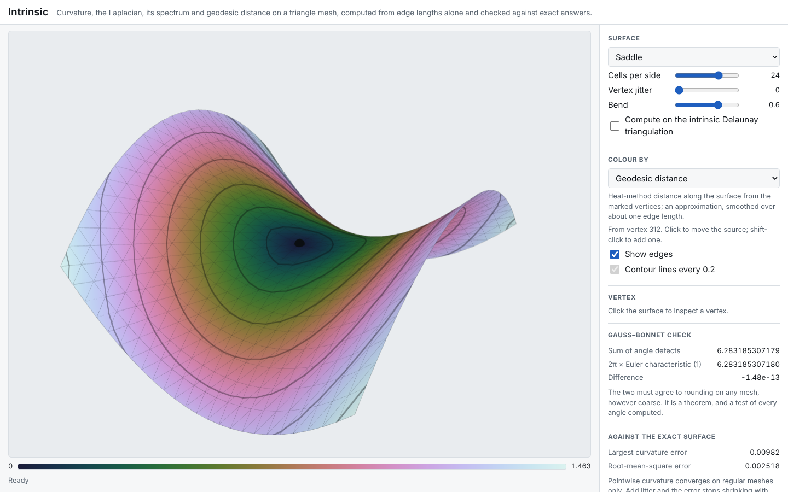

# PTisINTRINSIC

A browser lab for the geometry of triangle meshes, computed from edge lengths alone: curvature,
the Laplacian and its spectrum, intrinsic Delaunay triangulations and geodesic distance. Every
number on screen is computed in your browser. The methods are tested against closed-form answers
and against established libraries; [docs/results.md](docs/results.md) says which is checked
against what, and how closely they agree.



## What it computes

- **Curvature** from angle defects, with the discrete Gauss–Bonnet theorem as a running
  consistency check.
- **The cotan Laplacian**, the standard discretization of the Laplace–Beltrami operator.
- **Intrinsic Delaunay triangulations** by edge flips, which re-route edges across the surface
  without moving a vertex or changing the surface.
- **The spectrum** of the Laplacian by a dense symmetric eigensolve, with the eigenvalue counting
  function against Weyl's law and the spectral dimension of the heat trace.
- **Geodesic distance** by the heat method, on a sparse Cholesky factorization that is computed
  once and reused for every source you click.

"From edge lengths alone" is the point. No computation in `src/core` reads a vertex position;
positions are only turned into lengths, drawn and exported. One consequence is that the cone preset is the exact
flat cone, not a polyhedral approximation of one.

## How it is checked

1. **Exact answers.** Surfaces with known curvature, the unit square's spectrum, distance on a cone
   and a sphere, linear functions for the Laplacian. Where a method has an order of convergence,
   the tests measure it.
2. **Reference libraries.** A Python suite (`oracle/`) recomputes the same meshes with libigl,
   potpourri3d (geometry-central), SciPy and mpmath and compares. Where the results differ, the
   difference is explained and the explanation is itself tested.
3. **Random inputs.** Property tests with fast-check generate meshes and matrices. They found two
   real defects that every hand-written test had passed: an eigensolver failure on matrices with
   subnormal entries, and Delaunay flips that stopped short on steep, narrow bumps.
4. **Deliberate bugs.** `npm run mutation` plants a hand-picked list of plausible bugs in the
   code, one at a time, and requires a test to fail for each. The few that no correctness test
   can catch are listed with the reason. It is a curated list, not a mutation score.
5. **The app itself.** Playwright drives every surface and field on a desktop and a phone screen
   and allows no console errors or warnings.

## Results

Measured by `npm run report`, which writes [docs/results.md](docs/results.md) and this section.

<!-- results:start (generated by npm run report; do not edit) -->

- **Gauss–Bonnet.** The angle defects sum to 2πχ within 1.4e-13 on 840 random meshes (discs, spheres and tori, before and after edge flips). This checks the connectivity and each triangle's angle sum; the individual angles are checked against libigl and mpmath below.
- **Curvature.** On a regular grid the pointwise error falls at order 1.70 to 1.92 (2.4e+0, 7.3e-1, 1.9e-1, 5.2e-2 at 8, 16, 32, 64 cells per side). With 15% vertex jitter it stops falling (2.2e+0, 9.9e-1, 5.2e-1, 5.5e-1); angle defects are known to converge pointwise only on regular meshes. A cone's apex defect is right to 2.2e-16.
- **Intrinsic Delaunay.** Of 3,000 random bumps, 0 stop short of Delaunay; 20 of the 3,000 need parallel edges or loops to get there. Flipping changes no vertex's curvature by more than 2.7e-15.
- **Spectrum.** The first ten eigenvalues of the unit square converge at order 1.98 to 2.04; at 24 cells per side the worst is off by 1.4%.
- **Geodesic distance.** From a cone's apex or a sphere's pole, where the problem is symmetric, the largest error against the exact distance falls at order 2.00 and 1.98 to 2.00. From a general vertex it falls far more slowly: order 0.67 to 0.98 on the cone (1.8e-1, 9.3e-2, 4.8e-2, 3.0e-2) and 0.47 to 0.83 on the sphere (2.4e-1, 1.3e-1, 8.5e-2, 6.1e-2). That is how the method behaves with its standard time step, not an implementation defect: the same distances agree with potpourri3d's to the fifth digit.
- **Reference libraries.** Face areas are bit-identical to libigl's. The stiffness matrix differs from libigl's by 4.0e-16 (relative), eigenvalues from LAPACK's by 1.8e-14, heat-method distances from an independent SciPy implementation by 1.8e-14 and from potpourri3d by 2.0e-5. That last gap is one line of geometry-central, a 1e-6 shift of the Laplacian: with the same shift the SciPy implementation matches potpourri3d to 2.9e-15.
- **Thin triangles.** On 185 needle-shaped triangles, area and angles are within 1.93 and 2.12 units of roundoff of 80-digit arithmetic. The textbook Heron formula is wrong beyond 1e-8 on 85 of them.

<!-- results:end -->

## Limits

- **Pointwise curvature needs a regular mesh.** On an irregular one it stops converging.
- **Heat-method distance is an approximation**, smoothed over about one edge length, and it
  converges slowly: at first order or slower from a general vertex. On coarse or badly shaped meshes
  a few values can come out slightly negative. Flipping to the intrinsic
  Delaunay triangulation first helps a great deal; the app has a switch for it.
- **Very long meshes** (several hundred edges across) need a longer heat step, or the heat
  underflows; far too long a step evens the heat out. The library reports both as errors instead
  of returning a wrong distance.
- **The eigensolver is dense**, so the spectrum is limited to 1,100 vertices.
- **Edge lengths** must stay well inside the range of doubles, because the triangle formulas
  multiply four of them. Lengths outside that range are rejected.
- **Only `src/core` and the app's plain functions have unit tests.** The React components and the
  viewport are covered by the browser tests, which check what is computed and shown as text, not
  the pixels drawn.
- **A long computation cannot be cancelled.** A dense eigensolve holds up later requests.
- **Surfaces are built in.** There is no mesh upload yet.

## Run it

Node 22.18 or newer.

```sh
npm ci
npm run dev          # the app, at http://localhost:5173
npm run check        # ESLint, Prettier, tsc, unit tests with coverage, docs check, build
npx playwright install chromium
npm run test:e2e     # the app in a real browser, desktop and phone
```

The differential tests need Python 3.11, 3.12 or 3.13:

```sh
npm run fixtures     # exports meshes and results to oracle/fixtures
cd oracle
python -m venv .venv && . .venv/bin/activate
pip install -r requirements.txt
pytest
```

To regenerate the measured results, and to run the mutation check:

```sh
(cd oracle && python measure_agreement.py)
npm run report
npm run mutation -- --python oracle/.venv/bin/python
```

## Layout

| Path       | Contents                                                                         |
| ---------- | -------------------------------------------------------------------------------- |
| `src/core` | The numerical library. Pure TypeScript on typed arrays; no browser or Node APIs. |
| `src/app`  | The React app, the compute worker and the three.js viewport.                     |
| `tests`    | Unit and property tests (Vitest, fast-check).                                    |
| `e2e`      | Browser tests (Playwright).                                                      |
| `oracle`   | Differential tests in Python.                                                    |
| `scripts`  | Fixture export, the report, the documentation check and the mutation check.      |
| `docs`     | [Methods and references](docs/METHODS.md), [measured results](docs/results.md).  |

## Licence

Apache-2.0. See [LICENSE](LICENSE).

---

```text
 .-.
(o o)  PTisDEV
 |=|
```
